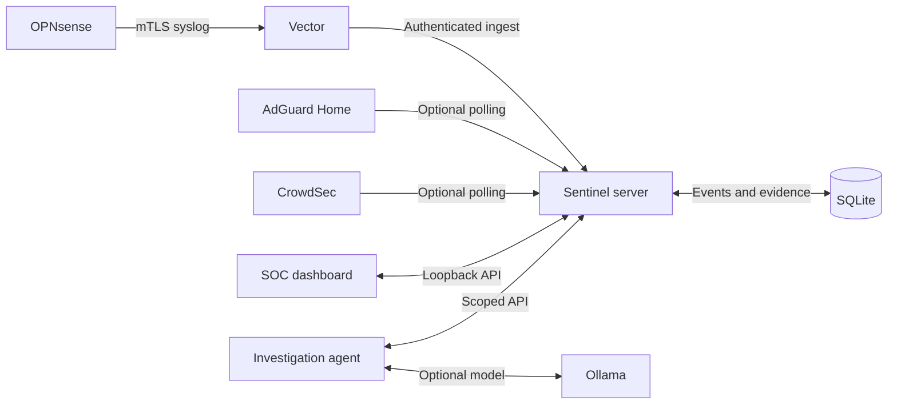

# NYRA Sentinel

**Self-hosted security monitoring for homelabs.**

Bring OPNsense, AdGuard Home, and CrowdSec telemetry into one dashboard. See what happened, review the evidence behind a detection, and investigate locally with an optional Ollama agent. Built by **Whyzper.Me** for Debian 13 and Docker Compose.

[](https://github.com/WhyzperMe/nyra-sentinel/actions/workflows/ci.yml)
[](https://github.com/WhyzperMe/nyra-sentinel/releases/latest)

[Download](#download) · [Install](#install-on-debian-13) · [Architecture](#architecture) · [Operations](#operations) · [Development](#development)

## What it does

| Capability | What you get |
| --- | --- |
| **Collect** | Receive OPNsense syslog over mutual TLS and optionally poll AdGuard Home query logs and CrowdSec decisions. |
| **Detect** | Apply deterministic rules and statistical signals to normalized events. Follow detections back to stored evidence. |
| **Investigate** | Browse events and incidents in the local SOC dashboard. Run an evidence query with the agent, with or without Ollama. |
| **Practice response** | Propose, approve, simulate, and roll back a response using scoped credentials and an audit trail. The workflow is simulation-only. |
| **Operate** | Check source health, verify SQLite backups, perform offline restores, and apply evidence-aware retention. |

## Download

| Asset | Use it for |
| --- | --- |
| [**Linux deployment archive (.tar.gz)**](https://github.com/WhyzperMe/nyra-sentinel/releases/download/v0.6.0/nyra-sentinel-v0.6.0.tar.gz) | Extract on Debian and build the stack with Docker Compose. |
| [**Source archive (.zip)**](https://github.com/WhyzperMe/nyra-sentinel/releases/download/v0.6.0/nyra-sentinel-v0.6.0.zip) | Inspect or transfer the same source package in ZIP format. |
| [**SHA‑256 checksums**](https://github.com/WhyzperMe/nyra-sentinel/releases/download/v0.6.0/SHA256SUMS.txt) | Verify either archive before extracting it. |

Both archives include the locked Rust source, Compose configuration, SQLite migrations, dashboard, maintenance scripts, documentation, and tests. Compose builds the server, agent, and response gateway from source.

**Release status** · The core stack is integration-verified. Production qualification still requires a soak test on the target Debian VM with your OPNsense and enabled integrations. [Engineering report](docs/validation-phase6.md)

## Install on Debian 13

Start with a dedicated Debian 13 VM. The initial sizing target is **2 vCPU, 4 GiB RAM, and 40 GB of storage**. Install Docker Engine with the Compose plugin, plus Python 3, OpenSSL, and curl. Plan to run Ollama separately at this VM size. [Debian package setup](docs/deployment.md#docker-engine-on-debian-13)

### 1. Download and verify

```bash
release="https://github.com/WhyzperMe/nyra-sentinel/releases/download/v0.6.0"
curl -fLO "$release/nyra-sentinel-v0.6.0.tar.gz"
curl -fLO "$release/SHA256SUMS.txt"
sha256sum --check --ignore-missing SHA256SUMS.txt
tar -xzf nyra-sentinel-v0.6.0.tar.gz
cd nyra-sentinel-v0.6.0
```

### 2. Initialize and start

Replace `192.168.1.200` with the VM's private IPv4 address. Initialization generates the local secrets and mTLS certificates.

```bash
sudo python3 scripts/sentinelctl.py init 192.168.1.200
sudo python3 scripts/sentinelctl.py doctor
sudo docker compose up -d --build --wait sentinel vector
sudo python3 scripts/sentinelctl.py status
sudo bash scripts/smoke-test.sh
```

If you're upgrading an existing installation, follow the backup and rollback procedure before starting the new stack. [Phase‑6 upgrade guide](docs/quickstart.md#upgrade-an-existing-phase-6-deployment)

### 3. Connect your sources

| Source | Setup |
| --- | --- |
| **OPNsense** | Configure remote syslog over TLS on TCP/6514. Import the CA certificate and dedicated client certificate and key. Keep the CA private key offline after enrollment. |
| **AdGuard Home** | Configure the query-log endpoint and credentials, then set `SENTINEL_ADGUARD_ENABLED=true`. |
| **CrowdSec** | Configure the LAPI endpoint and a dedicated bouncer key, then set `SENTINEL_CROWDSEC_ENABLED=true`. |

[Source setup and TLS settings](docs/deployment.md) · [Configuration reference](docs/configuration.md)

### 4. Open the dashboard

From your workstation, create an SSH tunnel to the VM.

```bash
ssh -N -L 8765:127.0.0.1:8765 user@SENTINEL_HOST
```

Open <http://127.0.0.1:8765/ui> and sign in with the operator token from `secrets/api_token` on the VM. The dashboard keeps the token in tab memory. Start with source status, then browse events, detections, and incidents. The detection detail API returns the evidence IDs for each detection.

## Architecture



The operator API is published on host loopback. Vector exposes the syslog listener on the configured VM address. Investigation tools use bounded read-only queries, with a separate credential for report submission. Response roles use separate bearer tokens and self-reported actor handles. [Trust boundaries](docs/architecture-and-acceptance.md) · [Response workflow](docs/response-safety.md)

Try an investigation using only the stored evidence.

```bash
sudo docker compose --profile agent run --rm agent --ip 192.168.1.10 --no-llm
```

Replace the sample IP with a host seen in your telemetry. [Local and remote Ollama setup](docs/deployment.md#local-vs-remote-ollama)

## Operations

| Task | Where to start |
| --- | --- |
| Check the stack | `sudo python3 scripts/sentinelctl.py status` |
| Inspect startup or ingest errors | `sudo docker compose logs --tail=100 sentinel vector` |
| Verify storage or readiness | `/api/v1/health` and `/api/v1/ready` on the local API |
| Back up, restore, or run retention | [Operations and recovery](docs/phase5-operations.md) |
| Investigate source gaps or late events | [Telemetry and detection limitations](docs/telemetry-limitations.md) |

## Development

```bash
cargo fmt --all -- --check
cargo clippy --locked --all-targets -- -D warnings
cargo test --locked --all-targets
bash scripts/verify-offline.sh
```

GitHub Actions also builds the release binaries and container image, exercises mTLS ingest and restart recovery, and opens the dashboard in Chromium. [Contributing](.github/CONTRIBUTING.md) · [Integration tests](tests/README.md)

Licensed under [MIT](LICENSE-MIT) or [Apache‑2.0](LICENSE-APACHE). Report vulnerabilities through the [security policy](.github/SECURITY.md).
